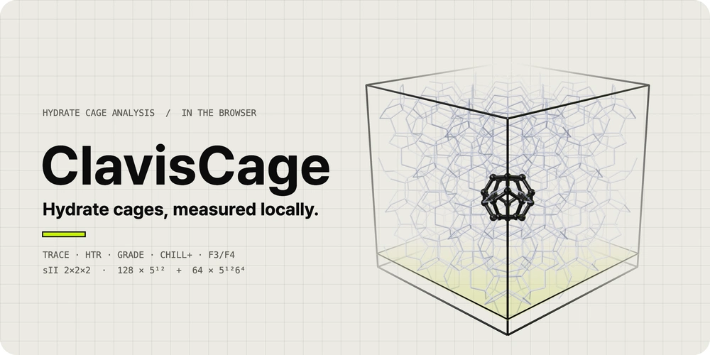
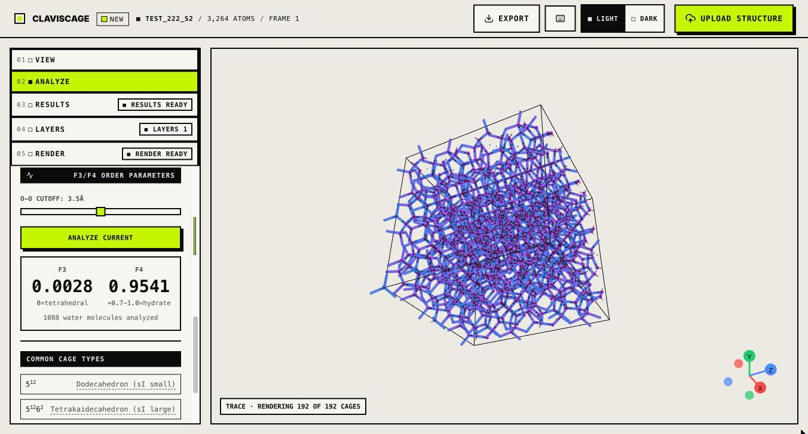

<div align="center">

<a href="https://claviscage.app">
  <picture>
    <source media="(prefers-reduced-motion: reduce) and (prefers-color-scheme: dark)" srcset="assets/cover/poster-dark.png">
    <source media="(prefers-reduced-motion: reduce)" srcset="assets/cover/poster-light.png">
    <source media="(prefers-color-scheme: dark)" srcset="assets/cover/cover-dark.webp">
    <source srcset="assets/cover/cover-light.webp">
    
  </picture>
</a>

# ClavisCage

**A browser-local workspace for clathrate-hydrate cage analysis.**<br>
Drop in a structure or an MD trajectory, find its cages, and export figures — nothing is uploaded.

### 🌐 [claviscage.app](https://claviscage.app) &nbsp;·&nbsp; 📖 [docs.claviscage.app](https://docs.claviscage.app)

[](https://claviscage.app)
[](https://docs.claviscage.app)
[](https://claviscage.app)
[](LICENSE.txt)
[](LICENSE-docs.md)
[](CITATION.cff)
[](https://buymeacoffee.com/woojingo)

[The app](#%EF%B8%8F-the-app) · [Quick start](#-quick-start) · [Inputs](#-supported-inputs) · [Methods](#-methods) · [Viewing](#%EF%B8%8F-viewing-and-styling) · [Exports](#-exports) · [Validation](#-validation) · [Citing](#-citing) · [FAQ](#-faq)

</div>

> [!NOTE]
> This repository holds the ClavisCage **analysis engine** (Rust, GPL-3.0-or-later) with its
> reference tests, plus documentation, method notes, a validation summary, the export bundle schema
> and citation metadata. The web app and the Blender extension are separate and not included. See
> [`NOTICE.md`](NOTICE.md).

## 🖥️ The app

<p align="center">
  <picture>
    <source media="(prefers-color-scheme: dark)" srcset="assets/screens/app-trace-dark.jpg">
    
  </picture>
  <sub>A perfect sII 2×2×2 crystal: TRACE draws all 192 cages (128 × 5¹² + 64 × 5¹²6⁴); F3 0.0028 and F4 0.954 read as hydrate.</sub>
</p>

ClavisCage opens in any current desktop browser and runs its analysis engine there, compiled to
WebAssembly. The workspace is a five-step panel beside the 3D scene:

| Step | What you do there |
|---|---|
| **01 View** | Camera (perspective / orthographic), axis views, PBC box, atom and bond styles, view or select mode |
| **02 Analyze** | Build a pipeline from TRACE, HTR, GRADE, CHILL+, F3/F4, averaged q4/q6, MCG-3 and tetrahedral order; set the frame range for a trajectory |
| **03 Results** | Cage counts by type, SEC / nSEC / IC, occupancy, charts over frames, CSV and JSON export |
| **04 Layers** | Add structure files as layers, pick the analysis layer, style each layer and residue |
| **05 Render** | Output frame and size, standard or path-traced PNG, frame sequences, MP4, Blender bundle |

Light and dark themes are one click in the header, and the 3D scene follows the theme. On a phone
the scene sits above the panel.

## ✨ At a glance

<table>
<tr>
<td width="33%" valign="top">

**🔒 Local by design**<br>
Files are read in your browser. No account, no upload, and the 3D scene and MP4 export keep working
offline.

</td>
<td width="33%" valign="top">

**🧊 Ten analyses**<br>
TRACE, HTR, GRADE, CHILL+, F3 / F4, averaged q4 / q6, MCG-3, tetrahedral order, guest occupancy and
minimum-image periodic distances, on one loaded system.

</td>
<td width="33%" valign="top">

**🎞️ Trajectories**<br>
GRO, PDB / mmCIF, GROMACS (GRO + XTC / TRR / TPR) and LAMMPS (data + dump). Large `.gro`
trajectories stream frame by frame.

</td>
</tr>
<tr>
<td valign="top">

**🖼️ Figures**<br>
Path-traced PNG at the sample count you choose, MP4 export, light and dark themes.

</td>
<td valign="top">

**📦 Blender bundle**<br>
A documented `.claviscage.zip` export for building scenes in Blender.

</td>
<td valign="top">

**✅ Checked numbers**<br>
Exact matches against reference outputs and perfect sI / sII crystals, listed with what is
**not** claimed.

</td>
</tr>
</table>

## ⚡ Quick start

1. Open **[claviscage.app](https://claviscage.app)** and choose *Open app*. There is nothing to
   install and no sign-in.
2. Click **Upload structure** (or drop files on the scene) and pick an import path:
   **GROMACS**, **LAMMPS** or **Static structure**. The guide narrows the file picker to the right
   types.
3. In **02 Analyze**, choose an algorithm and run it on the current frame or on a frame range.
4. Read the counts in **03 Results**, then export a PNG, an MP4, a CSV / JSON table or a Blender
   bundle from **05 Render**.

The [documentation](https://docs.claviscage.app/introduction) walks through
[uploading](https://docs.claviscage.app/getting-started/upload),
[visualization](https://docs.claviscage.app/getting-started/visualization),
[layers](https://docs.claviscage.app/getting-started/layers) and
[export](https://docs.claviscage.app/getting-started/export) step by step.

## 📂 Supported inputs

| Import path | Files | Notes |
|---|---|---|
| **GROMACS** | `.gro`; `.gro` + `.xtc` / `.trr`; `.tpr` + `.xtc` / `.trr` | Binary trajectories are indexed in a worker and decoded one frame at a time. `.gro` + trajectory keeps exact residue labels. |
| **LAMMPS** | `.data` + `.lammpstrj` / `.dump` / `.lammpsdump`; a dump alone with `type` (and `mol`) columns | A mapping wizard sets the unit style and which atom types are O, H and guests. |
| **Static structure** | `.gro`, `.pdb`, `.cif`, `.mmcif` | One structure, no trajectory. |

- **Water** is recognised by residue name: `SOL`, `HOH`, `WAT`, `H2O`, `TIP*`, `SPC*`, and the
  hydrate aliases `HSL`, `ICE`, `HYD`.
- **Guests** are any other molecular residues (methane, THF, cyclopentane, …); they feed the
  occupancy analysis. Slabs and minerals such as `SLAB`, `Fe`, `MMT` are kept as materials.
- **Large `.gro` trajectories** (100 MB and up) stream frame by frame instead of loading at once.
- **Periodic cells** come from the `.gro` box line, the PDB `CRYST1` record or the trajectory;
  triclinic cells are supported.

## 🔬 Methods

| Method | What it gives you | Note | Docs |
|---|---|---|---|
| **TRACE** | H-bond topology cages, any face signature, SEC / nSEC / IC | [trace.md](docs/methods/trace.md) | [docs](https://docs.claviscage.app/analysis/trace) |
| **HTR** | Primitive 4/5/6 rings and generalized `n4-n5-n6` cages | [htr.md](docs/methods/htr.md) | [docs](https://docs.claviscage.app/analysis/htr) |
| **GRADE** | `5^12`, `5^12·6^2`, `5^12·6^4` and filled-cage counts | [grade.md](docs/methods/grade.md) | [docs](https://docs.claviscage.app/analysis/grade) |
| **CHILL+** | Per-water ice / hydrate / interfacial / liquid classes | [chill-plus.md](docs/methods/chill-plus.md) | [docs](https://docs.claviscage.app/analysis/chill-plus) |
| **F3 / F4** | Three-body and torsional water-order parameters | [f3-f4.md](docs/methods/f3-f4.md) | [docs](https://docs.claviscage.app/analysis/f3f4) |
| **Averaged q4 / q6** | Locally averaged Steinhardt bond-orientational order per water (Lechner & Dellago) | [steinhardt.md](docs/methods/steinhardt.md) | — |
| **MCG-3** | Size of the largest mutually coordinated guest cluster (Barnes et al.) | [mcg.md](docs/methods/mcg.md) | — |
| **Tetrahedral order** | q (Errington & Debenedetti) with S_g and S_k (Chau & Hardwick) per water | [tetrahedral-order.md](docs/methods/tetrahedral-order.md) | — |
| **Occupancy** | θ_S, θ_L and overall guest occupancy | [occupancy.md](docs/methods/occupancy.md) | [docs](https://docs.claviscage.app/analysis/occupancy) |
| **Periodic boundaries** | Minimum-image distances in orthorhombic and triclinic cells | [mic-pbc.md](docs/methods/mic-pbc.md) | — |

Each analysis runs on the current frame, and TRACE, HTR, GRADE, F3 / F4 and CHILL+ also run over a
chosen *start / end / step* range of a trajectory, with a chart per frame. Each result keeps the
algorithm and the frame it came from, so results from different methods are never merged.

### Method registry and verification levels

The engine describes each method it implements (`list_methods`, `describe_method`) and runs any
series method by id with `run_method`, in WebAssembly and in Python. Each descriptor carries the
citation, DOI, parameters with ranges and a verification level:

| Level | Meaning | Methods |
|---|---|---|
| **T3** | Matches the authors' own program on the reference inputs | TRACE, HTR, GRADE |
| **T2** | Matches an established open implementation | Averaged q4 / q6, tetrahedral order |
| **T1** | Implemented from the paper, checked on cases with known answers | CHILL+, F3 / F4, MCG-3 |
| **T0** | Implemented from the paper only | none at present |

HTR is implemented from the paper and checked against the authors' published program; that program
carries no licence, and its code is not included here. Details are in
[`docs/methods/method-registry.md`](docs/methods/method-registry.md).

Anyone can propose a new method with a
[method request](https://github.com/wjgoarxiv/claviscage/issues/new?template=method_request.yml).
[`CONTRIBUTING.md`](CONTRIBUTING.md) lists what a request needs and the rules a method must meet to
ship; a per-frame method then appears in the web app and in Python without host-specific code.

## 🎛️ Viewing and styling

- **Overlays**: cage wireframes coloured by type, HTR rings, the hydrogen-bond network, the PBC box
  and axes, each toggled on its own.
- **CHILL+ colours**: classified waters are recoloured, with their O–O network and per-class filters.
- **Occupied guests**: highlight the guests that sit in detected cages, filtered by cage type.
- **Layers**: load waters, guests and slabs from separate files; each layer, and each residue
  inside it, gets its own visibility, size, opacity, colour and style.
- **Selection**: click or box-select atoms or residues; select all, invert, clear.
- **Session recovery**: a normal-size scene, with its layers and camera, survives an accidental
  refresh.

<details>
<summary>⌨️ Keyboard shortcuts</summary>

| Key | Action |
|---|---|
| `Space` | Play / pause a trajectory |
| `←` `→` | Previous / next frame |
| `C` | Cages on / off |
| `H` | Hydrogen bonds on / off |
| `B` | PBC box on / off |
| `X` | Axes on / off |
| `R` | Reset the camera |
| `V` / `S` | View mode / select mode |
| `Ctrl/⌘ + A`, `I`, `Esc` | Select all, invert, clear |
| `Ctrl/⌘ + E` | Save the current view as PNG |
| `?` | Shortcut help |

</details>

## 📤 Exports

| Export | Output | For |
|---|---|---|
| **Standard image** | PNG | The live view, cropped to the render frame you set |
| **Path-traced image** | PNG | Publication figures with soft shadows and depth of field |
| **Frame sequence** | ZIP of numbered PNGs | Trajectories, for your own video tools |
| **Movie** | MP4 (standard or path-traced) | Trajectories; encoded in the browser |
| **Tables** | CSV, JSON | One row per cage, or per frame for a trajectory |
| **Blender bundle** | `.claviscage.zip` | Rebuilding the current frame as an editable scene in Blender |

<details>
<summary>About the path tracer</summary>

The path tracer runs on the GPU through WebGL, with a CPU fallback for still images. You set the
output size (1280 × 720 by default) and the sample count, compose inside a preview frame, and can
click to focus, drag to change the aperture and click to place the light. Two looks are built in: a
glossy default and a matte ambient-occlusion style. CHILL+ colours, cage and H-bond styles and guest
highlights carry over from the live view. For very large systems, start small (about 640 px and 64
samples) and scale up once the framing is right.

</details>

## ✅ Validation

A few of the figures the engine reproduces:

| Check | Result |
|---|---|
| HTR, 1,242-water oracle | 216 cages = 54 `0-12-0` + 162 `0-12-2`, exact |
| TRACE / HTR, perfect GenIce2 sII 2×2×2 | 128 `5^12` + 64 `5^12·6^4` = 192 |
| TRACE / HTR, perfect GenIce2 sI | 128 `5^12` + 384 `5^12·6^2` = 512 |
| CHILL+, ice Ih / Ic, sI, sII | 100 % expected class |

The full table, including what each row does **not** claim, is in
[`docs/validation/benchmarks.md`](docs/validation/benchmarks.md).

## 📦 Blender bundle

The app's **Blender bundle** export is a single-frame `.claviscage.zip` with two members,
`manifest.json` and `scene.json`. It carries the frame's coordinates, cell, styles, CHILL+ and
H-bond data and one cage analysis with its parameters. Its shape is described in
[`docs/schema/claviscage-bundle.md`](docs/schema/claviscage-bundle.md), with a JSON Schema draft in
[`schema/`](schema/claviscage-bundle.v2.schema.json).

## 🦀 Engine

The analysis engine is a Rust crate in this repository (`src/`), licensed under GPL-3.0-or-later.
It holds the parser, periodic geometry, H-bond network, TRACE, HTR, GRADE, CHILL+, F3/F4, averaged
Steinhardt q4/q6, MCG-3, tetrahedral order, guest occupancy and the method registry (version
0.3.18). The web app runs the same code as WebAssembly, and the Blender extension loads it as a
Python wheel.

```bash
cargo test --lib                                   # unit and reference tests
cargo test --release                               # all tests, including the benchmark table (several minutes)
cargo build --release --features cli               # command-line tool
./target/release/clavis-cli trace tests/fixtures/crystals/222_S2.gro   # chill | trace | htr | grade | f3f4
maturin build --release --features pyo3            # Python wheel (import clavis_engine)
```

Requires a Rust 2021 toolchain; the wheel needs Python 3.11 or later and `maturin`. Reference
inputs live in `tests/fixtures/`: GenIce2 sI, sII, sH, Ih and Ic crystals, CH4-filled sI and sII
crystals, the first frame of the TRACE example, and the files the reference programs were run on,
with their expected outputs. `benchmarks/results.json` holds the benchmark table.

## 📚 Citing

[`CITATION.cff`](CITATION.cff) cites ClavisCage and lists the TRACE, HTR, HTR+, GRADE and CHILL+ papers
with DOIs; GitHub's *Cite this repository* button reads it. Each release is archived on Zenodo: [10.5281/zenodo.24112917](https://doi.org/10.5281/zenodo.24112917) cites every version, and [10.5281/zenodo.24112918](https://doi.org/10.5281/zenodo.24112918) is version 0.3.18. The papers for F3 / F4, averaged
q4 / q6, MCG-3 and tetrahedral order are listed below. Occupancy and the minimum-image convention
have no paper record here yet. If you report results from a method, please cite its paper as well.

<details>
<summary>Method papers</summary>

- J.-W. Hsu and S.-T. Lin, *J. Chem. Theory Comput.* 21 (2025) 11436–11454. [10.1021/acs.jctc.5c01459](https://doi.org/10.1021/acs.jctc.5c01459)
- Y. Liu, K. Xu, Y. Xu, J. Liu, J. Wu and Z. Zhang, *Nanotechnol. Rev.* 11 (2022) 699–711. [10.1515/ntrev-2022-0044](https://doi.org/10.1515/ntrev-2022-0044)
- Q. Shi, Z. Lin, Y. Qu, J. Wu and Z. Zhang, *J. Phys.: Condens. Matter* 36 (2024) 365901 (HTR+). [10.1088/1361-648X/ad52df](https://doi.org/10.1088/1361-648X/ad52df)
- F. Mahmoudinobar and C. L. Dias, *Comput. Phys. Commun.* 244 (2019) 385–391. [10.1016/j.cpc.2019.06.004](https://doi.org/10.1016/j.cpc.2019.06.004)
- A. H. Nguyen and V. Molinero, *J. Phys. Chem. B* 119 (2015) 9369–9376. [10.1021/jp510289t](https://doi.org/10.1021/jp510289t)
- Rodger et al., *Fluid Phase Equilib.* 116 (1996) 326, and Moon et al., *Faraday Discuss.* 136 (2007) 367 (F3 / F4). [10.1039/b618194p](https://doi.org/10.1039/b618194p)
- Lechner and Dellago, *J. Chem. Phys.* 129 (2008) 114707 (averaged q4 / q6). [10.1063/1.2977970](https://doi.org/10.1063/1.2977970)
- Barnes, Beckham, Wu and Sum, *J. Chem. Phys.* 140 (2014) 164506 (MCG). [10.1063/1.4871898](https://doi.org/10.1063/1.4871898)
- Errington and Debenedetti, *Nature* 409 (2001) 318 (q), and Chau and Hardwick, *Mol. Phys.* 93 (1998) 511 (S_g, S_k). [10.1038/35053024](https://doi.org/10.1038/35053024)

</details>

## 🗂️ What is in this repository

```text
src/                the Rust engine (GPL-3.0-or-later)
tests/              reference tests and fixtures
pytests/            Python binding tests
benchmarks/         benchmark table: every method on ideal crystals
docs/methods/       how each analysis works, which defaults it uses, and the method registry
docs/validation/    reference figures the engine reproduces
docs/schema/        the .claviscage.zip bundle, in prose
schema/             JSON Schema draft for the bundle
assets/cover/       the cover loop above and its provenance
assets/screens/     screenshots of the app
CITATION.cff        citation metadata
CONTRIBUTING.md     how to propose and add a method
```

## 💬 FAQ

<details>
<summary>Is it really free? Do I need an account?</summary>

Yes, and no. Every analysis and export is available to everyone, with no account, quota or
watermark.

</details>

<details>
<summary>Are my files uploaded anywhere?</summary>

No. Files are read and analysed in your browser; the site has no accounts and no analysis server.

</details>

<details>
<summary>Which browser should I use?</summary>

A current desktop browser with WebGL 2, which the 3D scene and the path tracer use. Very large
systems need a machine with plenty of memory, since everything runs on your computer.

</details>

<details>
<summary>My <code>.tpr</code> file is rejected or the residue names look wrong.</summary>

The browser reads a subset of TPR layouts and refuses the rest rather than guessing. Load the
matching `.gro` with the same `.xtc` / `.trr` instead; it carries every atom and residue name.

</details>

<details>
<summary>No water was found in my file.</summary>

Cage-forming waters must use one of the recognised residue names (`SOL`, `HOH`, `WAT`, `H2O`,
`TIP*`, `SPC*`, `HSL`, `ICE`, `HYD`). Rename the residue in your structure file and load it again.

</details>

<details>
<summary>Where is the source code?</summary>

The analysis engine, which produces every number the app reports, is here under GPL-3.0-or-later
(see [Engine](#-engine)). The web app's interface and the Blender extension are not published. See
[`NOTICE.md`](NOTICE.md).

</details>

<details>
<summary>A result looks wrong. What should I do?</summary>

Open a [methods question](https://github.com/wjgoarxiv/claviscage/issues/new/choose) with the
method, the counts you expected and where they come from. Please do not attach unpublished data you
cannot share.

</details>

## 🔒 Security and licence

Report security problems privately as described in [`SECURITY.md`](SECURITY.md).
The engine source is GPL-3.0-or-later ([`LICENSE.txt`](LICENSE.txt)); the writing in this
repository is CC BY 4.0 ([`LICENSE-docs.md`](LICENSE-docs.md)). The web app is not licensed by
either ([`NOTICE.md`](NOTICE.md)).

## ☕ Support

ClavisCage is free and has no accounts. If it saves you time, you can keep it running with a coffee.

<a href="https://buymeacoffee.com/woojingo"></a>

---

<div align="center">

**[Open ClavisCage →](https://claviscage.app)**

[App](https://claviscage.app) · [Docs](https://docs.claviscage.app) · [Methods](docs/methods/) · [Validation](docs/validation/benchmarks.md) · [Contributing](CONTRIBUTING.md) · [Changelog](CHANGELOG.md) · [Security](SECURITY.md)

</div>
